<div align="center">

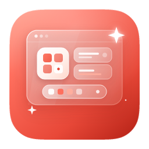

# Deskio

**Windows için sakin, özenle tasarlanmış masaüstleri. Beğenmezseniz tek tıkla her şeyi eski haline getirin.**

[](#-nasıl-kurulur)
[](#-nasıl-kurulur)
[](LICENSE)
[](https://v2.tauri.app/)

[English](README.md) · **Türkçe**

<br/>

Deskio, karmaşık bir Windows masaüstünü sakin ve özenli bir görünüme kavuşturur.<br/>Önce önizleyin, memnun kaldığınızda uygulayın. Fikrinizi mi değiştirdiniz? Tek tıkla her şeyi geri getirin.

</div>

## ↩️ İstediğiniz zaman geri dönebilirsiniz

Masaüstünüzü düzenlemek istiyor ancak bir şeyleri bozmaktan mı korkuyorsunuz? "Geri dönememe" endişesi çözdüğümüz ilk konudur:

- **Önce her şeyi yedekler**, masaüstünüzün bir fotoğrafını çekmek gibi: simgeler, oklar, duvar kâğıdı aynen korunur
- **Tek tıkla geri yükleme**, masaüstünüz tam olarak eski haline döner
- **Yalnızca bilgisayarınızda çalışır**: hesap yok, yükleme yok, çevrimiçi bağlantı yok
- **Teknik hiçbir ayara dokunmanız gerekmez**: seçin, önizleyin, tıklayın. Hepsi bu

<div align="center"><br/><br/><br/></div>

## ✨ Dokuz hazır görünüm

Her biri gerçek masaüstlerinde elle özenle ayarlandı. Birini seçin, bir kez tıklayın, tüm simgeler yeni tarzına kavuşsun. Aynı klasör, dokuz farklı görünüm:

<div align="center">
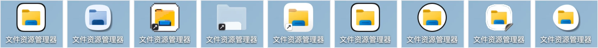
<br/>
<sub>Süper Elips · Ayrıntılı Plan · Piksel Çağı · Işıltı · Sırlı Porselen · Kalıp Kesim · Lomboz · Kupür Defteri · Dere Taşı</sub>
</div>

<br/>

<table align="center">
<tr>
  <td align="center"><br/><b>Süper Elips</b><br/><sub>akıcı köşeler</sub></td>
  <td align="center">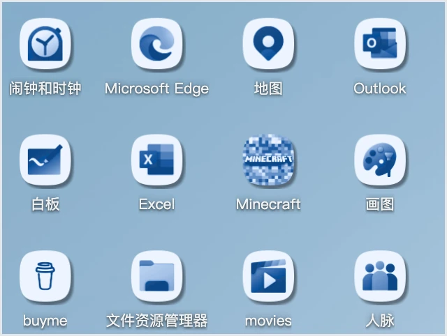<br/><b>Ayrıntılı Plan</b><br/><sub>mühendislik mürekkebi</sub></td>
  <td align="center">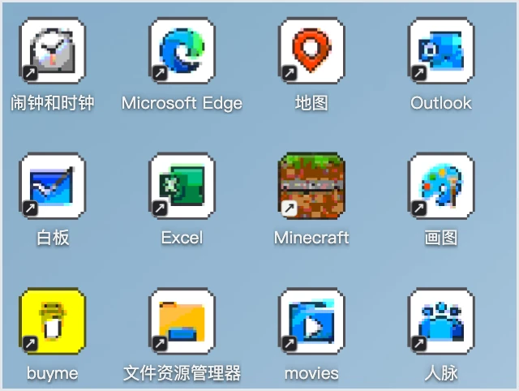<br/><b>Piksel Çağı</b><br/><sub>8-bit esintisi</sub></td>
</tr>
<tr>
  <td align="center">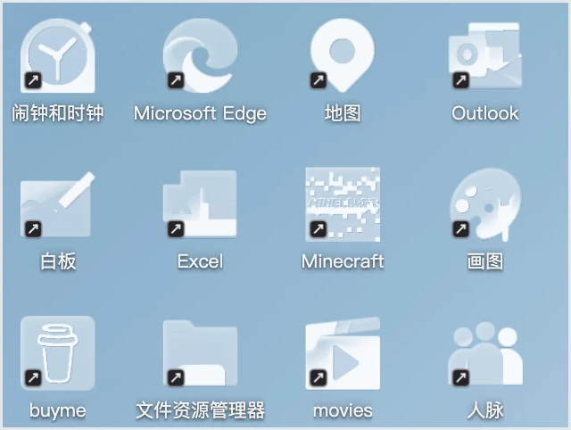<br/><b>Işıltı</b><br/><sub>ışıkla fırçalanmış</sub></td>
  <td align="center">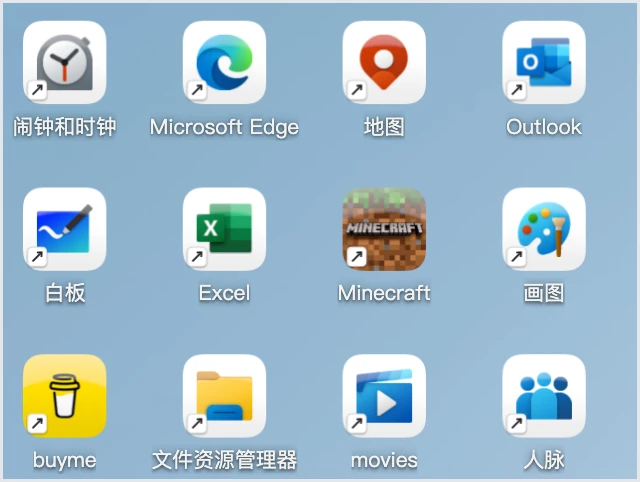<br/><b>Sırlı Porselen</b><br/><sub>serin porselen</sub></td>
  <td align="center">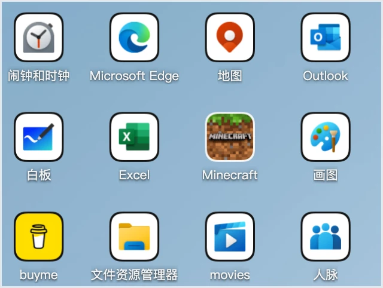<br/><b>Kalıp Kesim</b><br/><sub>çıkartma kenarlıkları</sub></td>
</tr>
<tr>
  <td align="center">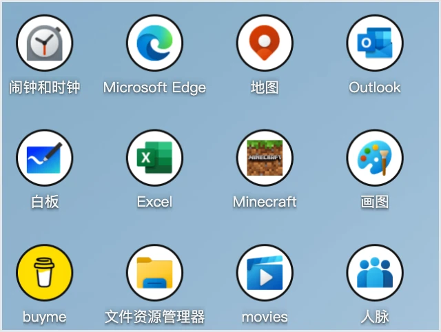<br/><b>Lomboz</b><br/><sub>temiz daireler</sub></td>
  <td align="center">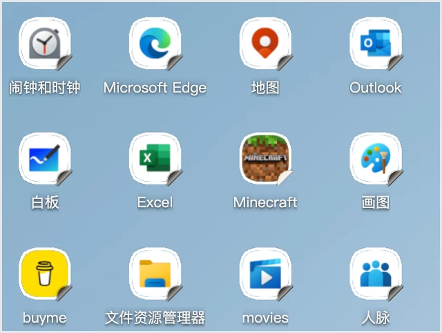<br/><b>Kupür Defteri</b><br/><sub>özenle yapıştırılmış</sub></td>
  <td align="center">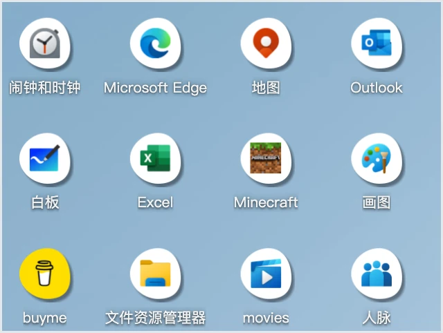<br/><b>Dere Taşı</b><br/><sub>akıntıyla yuvarlanmış taş</sub></td>
</tr>
</table>

## 🎨 Her parçayı kendinize göre özelleştirin

Bu dokuz stil bir başlangıç noktasıdır. On bir simge şekli, renk tonları, plakalar, kaplamalar ve kısayol işaretleri tek tek ayarlanabilir. Binlerce kombinasyon:

- Uygulamalar, klasörler ve standart dosyalar kendi stillerine sahip olabilir
- Orijinalle karşılaştırmak için basılı tutun, tek bir simgeyi yeniden biçimlendirmek için sağ tıklayın, özgürce geri alın ve yineleyin

<div align="center">
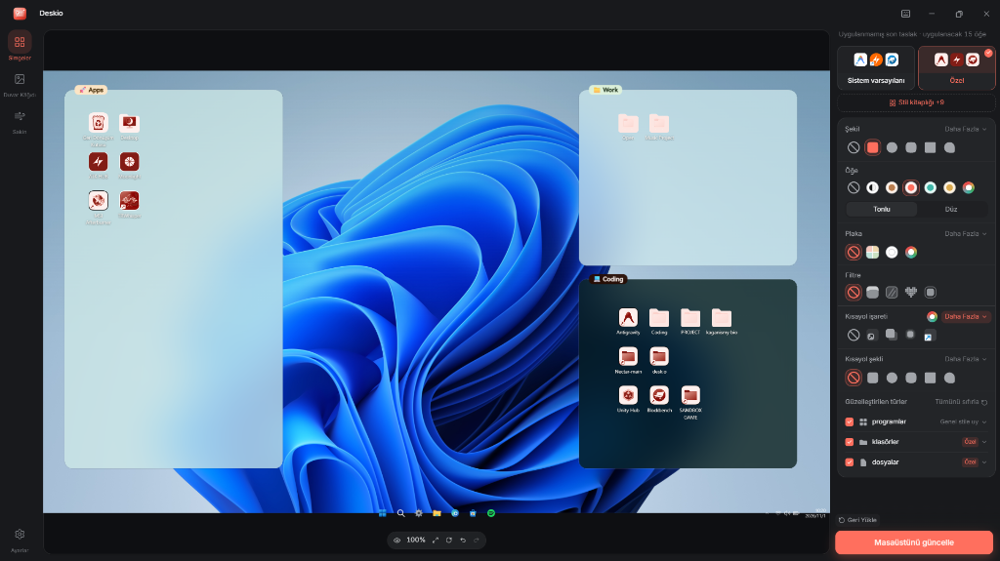
<br/>
<sub>Solda yakınlaştırılmış canlı önizleme; sağda her özelliği ayarlanabilir kontrol paneli.</sub>
</div>

## 🧩 Kaydedin. Paylaşın.

Çok sevdiğiniz bir kombinasyon mu yakaladınız? Kendi stiliniz olarak kaydedin ve tek tıkla tekrar kullanın. Bir arkadaşınız için dosya olarak dışa aktarın veya diğer kullanıcıların hazırladığı stil paketlerini içe aktarın.

<div align="center">
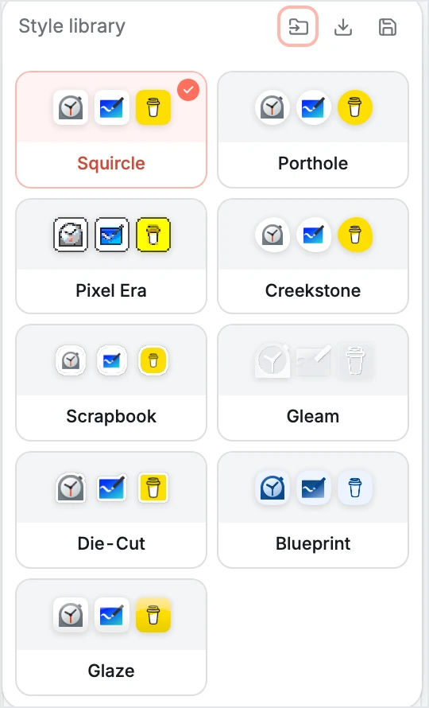
<br/>
<sub>Kitaplığınız hazır stillerin hemen yanında yer alır: kaydedin, dışa aktarın, içe aktarın.</sub>
</div>

## 🗂️ Duvar kâğıdınızda bölgeler oluşturun

Simgeler birbirine mi karışıyor? Duvar kâğıdınıza yarı saydam bölgeler çizin: biri iş için, biri eğlence için. İstediğiniz yere sürükleyin, istediğiniz boyuta getirin; beş materyal, dört başlık stili veya tek tıkla hazır bir düzen şablonu yerleştirin. Duvar kâğıdınız yedeklenir; bölgeleri kaldırmak tek bir tık kadar kolaydır.

<div align="center">
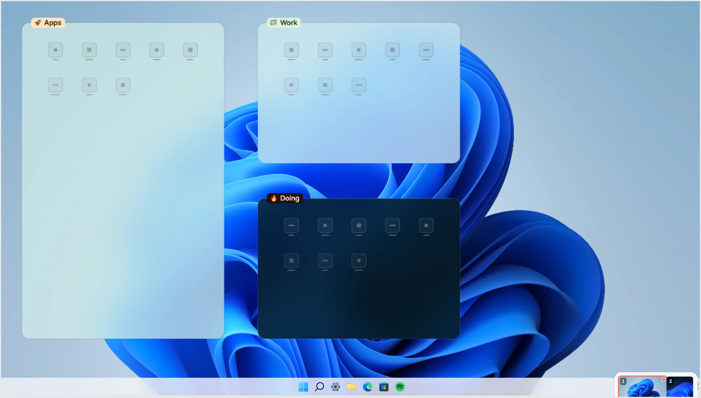
<br/>
<sub>Tek bir şablon tıklaması bu üç bölgeyi masaüstünüze yerleştirdi.</sub>
</div>

## ✂️ Küçük kısayol oku: değiştirin veya kaldırın

Windows'un o küçük kısayol okunu çirkin mi buluyorsunuz? Daha zarif bir işaretle değiştirin veya tamamen kaldırın. Uygulama bunu sizin için yapar; Windows bir kez izin ister ve onay verirsiniz. Önce yedeklenir, tek tıkla eski haline döndürülür.

> Ayrıca Windows'un can sıkıcı önerilerini susturan yerleşik bir Sakin yardımcısı bulunur. Her değişiklikten önce onayınızı alır ve her değişiklik geri alınabilir.

<div align="center"><br/><br/><br/></div>

## 🎛️ Stüdyo deneyimi

<div align="center">
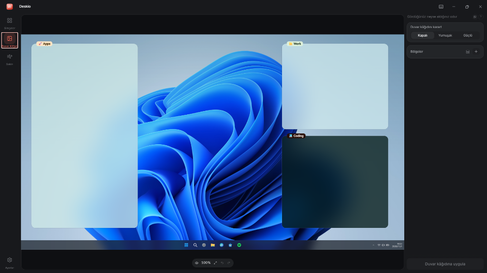
<br/>
<sub>Her sekme aynı mantıkla çalışır: sağda ayarlayın, solda gerçek masaüstünüzün anlık değişimini izleyin.</sub>
</div>

## 📦 Nasıl kurulur

İlk yükleyici hazırlanmaktadır ve [Releases](https://github.com/kagangungor/deskio/releases) sayfasına eklenecektir. İndirin, çift tıklayın ve hazırsınız. Yalnızca kendi kullanıcı hesabınız için yüklenir.

> Windows mavi "Kişisel bilgisayarınız korundu" ekranı gösterirse endişelenmeyin. Bu bir virüs uyarısı değil, Windows'un yeni yazılımlara karşı varsayılan tedbiridir. **Ek bilgi**'ye ve ardından **Yine de çalıştır**'a tıklayın.

Windows 10 (1809 veya daha yeni) ve Windows 11 (64-bit) üzerinde çalışır.

## 💬 Sıkça sorulan sorular

**Bilgisayarıma zarar verebilir mi veya beni yarı yolda bırakabilir mi?**
Herhangi bir şeyi değiştirmeden önce masaüstünüzü yedekler ve her değişiklik tek bir tıkla geri alınabilir. Rahatça deneyebilirsiniz.

**Bilgisayarımı yavaşlatır mı?**
Fark edilir hiçbir etkisi olmaz. Ağır işlem yalnızca siz uygula düğmesine bastığınızda bir kez gerçekleşir; geri kalan zamanda sessizce bekler.

**Yeniden başlatma sonrasında korunur mu?**
Evet. Yeniden biçimlendirilen simgeler gerçek görsel dosyalarıdır. Büyük bir Windows güncellemesi bazı ayarları sıfırlarsa tek tıkla yeniden uygulayabilir veya geri yükleyebilirsiniz.

**Ücretsiz mi? Herhangi bir veri yükleniyor mu?**
Tamamen ücretsiz ve açık kaynaktır. Yalnızca bilgisayarınızda çalışır; hesap gerekmez, hiçbir veri hiçbir yere gönderilmez.

**Bilgisayardan pek anlamıyorum. Yine de kullanabilir miyim?**
Evet. Bir görünüm seçin, önizlemeye bakın, uygula'ya tıklayın. Komut yok, teknik karmaşa yok; geri yükleme her zaman tek tık uzaklıkta.

<div align="center"><br/><br/><br/></div>

## 🧬 Güçlü ve deterministik Rust çekirdeği

Her görünüm hiçbir platform bağımlılığı olmayan saf Rust mimarisine sahip [`dm-icon-core`](crates/dm-icon-core) tarafından oluşturulur. Simgeleri işlemeden önce analiz eder — sınıflandırma, arka plan algılama, nesne/arka plan ayrımı, baskın renk — ardından katı kurallarla yeniden işler. Makine öğrenimi yok, bulut yok, telemetri yok: aynı girdi her seferinde tamamen çevrimdışı olarak aynı pikselleri üretir.

## 🏗️ Mimari ve teknoloji tercihleri

Deskio, sistem WebView'ı (WebView2) içinde çalışan **React 19 + TypeScript** arayüzüne sahip bir **Tauri 2 + Rust** masaüstü uygulamasıdır. Pikseller tek bir Rust simge çekirdeği tarafından yönetilir:

```
React UI ──(tauri-specta köprüsü)──▶ Rust host
  │                                   │
  │  canlı önizleme + tasarım paneli  ├─ dm-icon-core   tek piksel gerçeği
  │  WYSIWYG tuval (Pixi duvar kâğıdı)│                 (WASM + yerel)
  └─ tarayıcı geliştirme sahte sunucu ├─ dm-windows     kabuk · kayıt defteri · geometri
                                      ├─ dm-operations  anlık görüntü · uygula · geri yükle
                                      ├─ dm-resident    sistem tepsisi + mutabakat
                                      └─ dm-elevated    küçük izinli yardımcı
```

## 🛠️ Geliştiriciler için

[**Bun**](https://bun.sh) ≥ 1.1 ve [`rust-toolchain.toml`](rust-toolchain.toml) içinde belirtilen Rust araç zincirine ihtiyacınız vardır.

```bash
bun install
bun run dev          # tarayıcıda sahte sunucu ile web arayüzü — anında yenileme
bun run tauri:dev    # tam masaüstü uygulaması (Windows) — Rust host'u derler ve pencereyi açar
```

## 🤝 Katkıda Bulunma

React arayüzü, Rust çekirdeği, dokümantasyon, yerelleştirme ve Windows uyumluluk testleri için katkılarınızı memnuniyetle karşılıyoruz. Ayrıntılar için [`CONTRIBUTING.md`](CONTRIBUTING.md) belgesini inceleyebilirsiniz.

## 📄 Lisans

[MIT](LICENSE) © 2026 [Kağan Güngör](https://github.com/kagangungor). Ücretsiz ve açık kaynak.

<div align="center">

**Masaüstünüzü güzelleştirdi mi? [Bir ⭐ verin](https://github.com/kagangungor/deskio) ki daha çok kişi keşfetsin.**


<br/><b>Deskio</b><br/><sub>[Releases](https://github.com/kagangungor/deskio/releases) · [Issues](https://github.com/kagangungor/deskio/issues) · [English](README.md) · [Türkçe](README.tr.md)</sub>

</div>
